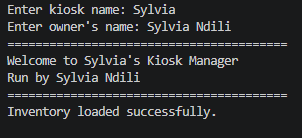
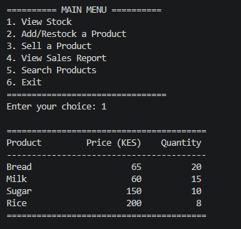
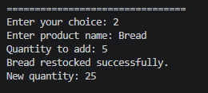
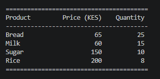
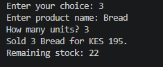
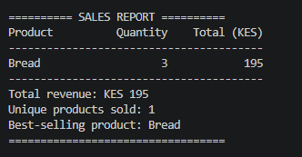
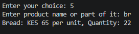
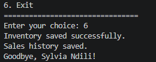

# Kiosk Manager

## Project Overview

Kiosk Manager is a Python command-line application developed as a Data Structures and Algorithms capstone project. It is designed to help a small kiosk manage its stock, record product sales and keep inventory data saved between program runs.

## Features

- View available products, prices and quantities.
- Add new products and restock existing products.
- Sell products while checking stock availability.
- Calculate sales revenue and identify the best-selling product.
- Search for products using partial names.
- Save inventory to a text file and load it when the program starts.
- Append sales records to a sales history file.
- Validate numeric inputs to handle common user mistakes.

## Technologies and Concepts

This project uses Python 3 and few concepts learned:

- Variables and data types
- Conditional statements
- `while` and `for` loops
- Functions
- Dictionaries, lists, tuples and sets
- String methods and f-strings
- Text file reading and writing

## Project Files

- `kiosk_manager.py`: Main application.
- `inventory.txt`: Saved inventory data, generated by the application.
- `sales.txt`: Appended sales history, generated by the application.
- `.gitignore`: This excludes Python cache files from version control.

## Requirements

- Python 3 installed on your computer.
- A terminal or code editor such as VS Code.

## How to Run

1. Clone or download this repository.
2. Open a terminal in the project directory.
3. Run the application:

   ```bash
   python kiosk_manager.py
   ```

   On some systems, use `py kiosk_manager.py` or `python3 kiosk_manager.py`.

4. Follow the menu prompts to manage stock and record sales.

## Data Storage

The application saves the current inventory to `inventory.txt` when exiting. On the next run, it loads the saved inventory if the file contains valid records. Sales from each session are appended to `sales.txt`, preserving previous records.


## Screenshots

### 1. Welcome Screen
Enter the kiosk name and owner's name. The program displays a welcome message using the details provided.



### 2. View Stock
Select option `1` to display the four default products: Bread (KES 65, quantity 20), Milk (KES 60, quantity 15), Sugar (KES 150, quantity 10), and Rice (KES 200, quantity 8).



### 3. Restock Bread
Select option `2`, enter `Bread`, and add 5 units. The Bread quantity should increase from 20 to 25.




### 4. Sell Bread
Select option `3`, enter `Bread`, and sell 3 units. The total sale should be KES 195, and the remaining Bread stock should be 22 units.



### 5. Sales Report
Select option `4` to view the sales report. It should show total revenue of KES 195, one unique product sold and Bread as the best-selling product.



### 6. Search Products
Select option `5` and enter `br`. The program should find and display Bread, including its price of KES 65 and its current quantity of 22 units.



### 7. Exit and Save Data
Select option `6` to exit. The program should save the updated inventory and append the recorded sale to the sales history file.



## Learning Outcomes

This project demonstrates how Python data structures, functions, loops, conditionals, string handling and file operations can be combined to solve a practical inventory management problem. It also provides practice in validating user input, calculating sales totals and maintaining data between program runs.